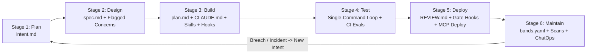

# Reference Analysis: The AI-Native SDLC Playbook (Anthropic / Claude)

- **Source URL:** https://claude.com/resources/articles/the-ai-native-sdlc-playbook
- **Author:** Louis Claxton (Anthropic Applied AI Team)
- **Published Date:** August 21, 2026
- **Purpose in This Repository:** ใช้เป็นเอกสารวิเคราะห์อ้างอิงหลัก (External Benchmark) เพื่อเทียบเคียงและปรับจูนการออกแบบ **AI-Native SDLC Agent Framework** ตาม [ROADMAP.md](../../../ROADMAP.md) และ [implementation-plan-packet.md](../../plans/implementation-plan-packet.md)

---

## 1. Core Thesis: เมื่อโค้ดไม่ใช่คอขวดอีกต่อไป

Anthropic ชี้ให้เห็นว่า SDLC แบบดั้งเดิมถูกออกแบบมาเพื่อยุคที่ **"การเขียนโค้ด (Build)" เป็นขั้นตอนที่แพงและช้าที่สุด** แต่เมื่อ AI coding agents (เช่น Claude Code) ลดเวลาในการเขียนโค้ดลงจากสัปดาห์เหลือหลักชั่วโมง ปัญหาใหม่ 3 ข้อจึงเกิดขึ้น:

1. **คอขวดย้ายไปทางซ้ายและขวาของ Build:** ขั้นตอน Plan, Design, Review/Test และ Deploy ยังวิ่งด้วยความเร็วระดับมนุษย์ (Human-speed)
2. **Controls เดิมพังเมื่อปริมาณ Diff เพิ่มทวีคูณ:** การให้คนนั่งอ่านโค้ดทีละบรรทัด (Line-by-line review) รับมือกับโค้ดที่ AI สร้างไม่ได้อีกต่อไป
3. **ต้นทุน Governance พุ่งสูง:** ข้อยกเว้นและการอนุมัติยังติดอยู่กับรอบประชุมรายสัปดาห์หรือรายเดือน

**ทางออกของ Playbook:** เปลี่ยน SDLC จากท่อส่งแบบเส้นตรง (Linear handoff) ให้เป็น **Closed-Loop Artifact-Driven System** ที่แต่ละ Stage จบลงด้วยการ commit **Version-controlled Markdown / Config Artifact** ลง Git เพื่อให้ Stage ถัดไปอ่านและทำงานต่อได้ทันที ขณะที่มนุษย์ย้ายจุดโฟกัสไปควบคุมที่ **Intent, Spec, Guardrails และ Approval Gates**

---

## 2. สถาปัตยกรรมหลัก: 6 Stages & 15 Plays

บทความแบ่งการปรับโฉม SDLC ออกเป็น **6 ระยะ** โดยมี **15 Plays** และระบบวัดผลทั้ง **Leading Indicators** (วัดความเร็ว/สัญญาณเริ่มต้น) และ **Lagging Indicators** (วัดคุณภาพ/ผลลัพธ์ปลายทาง):

### Stage 1: Plan
- **Play 1 — Capture as `intent.md`:**
  - *แนวคิด:* ผู้คิดไอเดีย (ไม่ต้องเป็นสาย Dev) คุย brainstorm กับ AI จนได้ proto-spec ในภาษาของตัวเองแล้ว commit เป็น `intent.md` ลง Git (หรือเชื่อมจากระบบเดิม) เพื่อลดการสูญเสียความหมายจากการส่งต่อหลายทอด
  - *ตัวชี้วัด:* Leading = เวลาตั้งแต่เริ่มคุยจนได้ `intent.md` commit; Lagging = อัตราการผ่านเข้า Design (Survival rate) และจำนวนการแก้ไข `intent.md` หลังเริ่มเขียน `spec.md`

### Stage 2: Design
- **Play 2 — Requirements and Design:**
  - *แนวคิด:* ยุบขั้นตอนเขียน Requirement และ Design มารวมใน Working Session เดียว โดยบังคับให้ AI โหลดองค์ความรู้องค์กรผ่าน **Skills** (Brand, Security, Compliance, UX) มาช่วยสร้าง `spec.md` พร้อมปักธง **Flagged Concerns** จุดที่นโยบายขัดกันให้คนตัดสินใจทันที แทนที่จะไปเจอตอน Review ปลายทาง
  - *ตัวชี้วัด:* Leading = เวลาจาก `intent.md` commit ถึง `spec.md` commit; Lagging = จำนวน commit แก้ไข `spec.md` หลังเข้าขั้น `plan.md`

### Stage 3: Build
- **Play 3 — Plan Mode as Default Starting Point:**
  - *แนวคิด:* ห้ามแก้โค้ดก่อนมีแผนที่ตกลงกันแล้ว Agent ต้องสำรวจ codebase แบบ read-only แล้วสร้าง `plan.md` (ไฟล์ที่จะแก้, ลำดับงาน, ความเสี่ยง, วิธีพิสูจน์/Test) ให้วิศวกรตรวจสอบก่อนลงมือทำ และต้องซิงก์ `plan.md` ให้ตรงกับโค้ดเสมอ
  - *Auto Mode & Legacy Coexistence:* เมื่อ Guardrails พร้อมแล้วจึงเปิด Auto mode ได้ สำหรับองค์กรที่มี Jira / ServiceNow / Figma อยู่แล้ว เลือกกำหนด Source of Truth ได้ 3 แบบ: (1) Repo as SoT, (2) Legacy tool as SoT + connector, หรือ (3) Linkage ระหว่าง Record ID กับ Commit SHA
  - *ตัวชี้วัด:* Leading = อัตราที่ PR merge ผ่านในรอบแรก & เวลาจาก Plan approval ถึง Merge; Lagging = รอบการ Rework และความสอดคล้องระหว่าง Diff กับ `plan.md`
- **Play 4 — The `CLAUDE.md`:**
  - *แนวคิด:* คู่มือสำหรับวันแรกของทีม (ไม่เกิน 1 หน้า) รวม Commands (Build/Test/Lint), Conventions, Architecture และ **"Mistake Log"** — กฎเหล็กคือ *"ถ้า AI ทำผิดซ้ำครั้งที่ 2 ให้เพิ่มกฎป้องกันลงใน `CLAUDE.md` ทันที"*
  - *ตัวชี้วัด:* Leading = ความถี่ที่ AI ทำผิดซ้ำเรื่องเดิม; Lagging = เวลาจนถึง First Merged PR ของสมาชิกใหม่
- **Play 5 — Skills as Institutional Knowledge:**
  - *แนวคิด:* แปลงมาตรฐานองค์กร (เช่น Secure API standard) เป็นโฟลเดอร์ `SKILL.md` ที่ Trigger อัตโนมัติตามบริบท โดยย้ำว่า **Skill เป็น Advisory Control (คำแนะนำ)** ถ้ากฎไหนห้ามละเมิดเด็ดขาดต้องมี **Hook (Deterministic Control)** หนุนหลัง
  - *ตัวชี้วัด:* Leading = เวลาตั้งแต่ Policy owner อนุมัติจน Skill ถูก merge; Lagging = จำนวน Review findings ที่อ้างถึง Policy นั้น (ควรลดลงเข้าใกล้ศูนย์)
- **Play 6 — Hooks as Build-time Guardrails:**
  - *แนวคิด:* สคริปต์ที่รันเร็วและสโคปแคบระหว่าง Agent ทำงาน เช่น บล็อกการแก้ Protected paths, รัน Formatter/Linter ทันทีหลังแก้ไฟล์, กัน Credential หลุดเข้า Diff (ส่วนงานหนักเก็บไว้ทำตอน commit/PR และงานถามคนอนุมัติเก็บไว้ที่ Stage 5)
- **Play 7 — Parallel Sessions and Subagents:**
  - *แนวคิด:* แยก Parallel Sessions ด้วย **`git worktree`** (เริ่มจาก 2–3 sessions ตามความสามารถในการ Review ของคน) และแยกงานที่ทำซ้ำๆ ออกเป็น **Scoped Subagents** เช่น `verifier`, `code simplifier`, `researcher` ที่มี context window และ tool limits แยกของตัวเอง
  - *ตัวชี้วัด:* Leading = จำนวน concurrent sessions ที่ยังคงคุณภาพ Review; Lagging = Changes merged/week เทียบกับ Rework rate

### Stage 4: Test
- **Play 8 — Give Claude a Feedback Loop:**
  - *แนวคิด:* Agent ต้องมีคำสั่งเดียวที่รัน Build/Test/Lint แล้วรู้ผลเองได้ (`make test`, `npm test`) รวมถึง MCP Browser/Screenshot สำหรับงาน UI
  - *กฎสำคัญสำหรับ Bug Fix:* ให้ Agent เขียน Failing Test เพื่อ reproduce bug ก่อน → ยืนยันว่า Fail จริง → Commit Test → แล้วค่อยให้แก้โค้ด **โดยใช้ Hook ห้าม Agent แก้ไฟล์ Test ระหว่างแก้ Bug** เพื่อป้องกัน Agent โกง Test
  - *ตัวชี้วัด:* Leading = First-pass CI success rate; Lagging = Review time per PR และ Change Failure Rate
- **Play 9 — Continuous Evals in CI:**
  - *แนวคิด:* มองไฟล์ Config (`CLAUDE.md`, Skills, Hooks) เหมือนซอฟต์แวร์จริง รวบรวมงานจริง 20–50 เคส + เคสจาก Production Incident มาทำเป็น Eval Suite รันใน CI ทุกครั้งที่มี PR แก้ Config หรือเปลี่ยน Model และรันตาม Schedule
  - *ตัวชี้วัด:* Leading = Eval pass rate และเวลาในการแปลง Incident เป็น Permanent Eval; Lagging = อัตรา Regression ที่จับได้ใน CI เทียบกับที่หลุดไป Production

### Stage 5: Deploy
- **Play 10 — AI in the PR Review Loop (`REVIEW.md`):**
  - *แนวคิด:* แยกหน้าที่ (Separation of Duties) — Agent ที่เขียนโค้ดไม่มีสิทธิ์ Approve เอง ทุก PR ต้องผ่านการตรวจตามกติกาใน `REVIEW.md` แบ่งเป็น Pass (Bugs, Security, Compliance กับ `spec.md` & `plan.md`) พร้อมแยกความรุนแรง (Important vs Nit) และจำกัดจำนวน Nit (เช่น ไม่เกิน 5 ข้อ) เพื่อไม่ให้ Reviewer ตาลาย
  - *ตัวชี้วัด:* Leading = Time to first review และสัดส่วนคอมเมนต์ที่ Agent แก้ให้เอง; Lagging = Defects/Vulns ที่จับได้ก่อน Merge เทียบกับที่หลุดไป Production
- **Play 11 — Hooks as Approval Gates & Managed Enterprise Settings:**
  - *แนวคิด:* ใช้ Hook แบบ `PreToolUse` คืนค่า Exit code `2` พร้อมข้อความอธิบายเพื่อบล็อกคำสั่งอันตราย (เช่น deploy production โดยไม่มี `RELEASE_APPROVAL`)
  - *Enterprise Hardening Pattern:* บังคับใช้ Managed Settings ที่ Engineer ปิดเองไม่ได้ (`disableBypassPermissionsMode`, `allowManagedPermissionRulesOnly`, `sandbox.enabled` + `failIfUnavailable: true`, `allowUnsandboxedCommands: false`, บล็อก `~/.ssh` / `~/.aws/credentials`, `allowManagedHooksOnly`, `allowManagedMcpServersOnly`)
  - *ตัวชี้วัด:* Leading = เวลาที่รอในแต่ละ Approval gate (ผ่าน OpenTelemetry); Lagging = Gate violations ที่หลุดถึง Production
- **Play 12 — CI/CD Integration and Deployment:**
  - *แนวคิด:* ไล่ระดับจาก Read-only triage (`claude -p` สรุป Build fail) → Write jobs ผ่าน Branch Protection (ห้าม push ตรงเข้า `main`) → Expose deployment/rollback ผ่าน **MCP allowlist** แทนการแจก shell credentials และซ้อม **Single-command Rollback** ใน Staging ให้ชำนาญก่อนใช้จริง
  - *ตัวชี้วัด:* Leading = สัดส่วน Pipeline failures ที่ Triage ได้โดยไม่ต้อง page คน; Lagging = DORA Metrics

### Stage 6: Maintain
- **Play 13 — Maintenance and Closing the Loop (`bands.yaml`):**
  - *แนวคิด:* ใช้ **Deterministic Script** (ไม่ใช้ LLM) เฝ้า Metrics เทียบ Rolling Baseline (เช่น 30 วัน + Western Electric rules) แล้วแบ่ง Tier การตอบสนองใน `bands.yaml`:
    - `1σ`: Log อย่างเดียว
    - `2σ`: เรียก Agent แบบ **Read-only** มาวินิจฉัย
    - `3σ`: เสนอ PR แก้ไขหรือเรียก Pre-approved Rollback Runbook + **เขียน `intent.md` ใหม่กลับเข้า Stage 1**
  - *ตัวชี้วัด:* Leading = เวลาจาก Band breach จนเกิด `intent.md` ในคิว Triage; Lagging = สัดส่วนที่กลายเป็น Merged Fix และอัตราการเกิดปัญหาซ้ำ
- **Play 14 — Recurring Codebase Scans:**
  - *แนวคิด:* สแกนความปลอดภัยทั้ง Repo ตามรอบเวลา (เช่น รายสัปดาห์) เพื่อจับช่องโหว่เชิงบริบทที่ Static Analysis จับไม่ได้ งานเล็กส่งเป็น PR ผ่าน Gate งานใหญ่แปลงเป็น `intent.md`
- **Play 15 — Claude on Call (ChatOps / Incident Channel):**
  - *แนวคิด:* นำ Agent เข้าไปอยู่ในช่อง Incident (เช่น Slack/Teams) ภายใต้ Identity แยก ตรวจสอบ Metric ผ่าน MCP แล้วสร้าง PR หรือ `intent.md` พร้อมบันทึก Post-mortem ลง Git เป็นความจำระยะยาว

---

## 3. สรุป Artifact Flow และ Governance Model

**แกนหลัก 4 ข้อที่ห้ามตกหล่น:**
1. **Advisory vs. Deterministic:** Skills/Prompts = แนะนำให้ทำดี; Hooks/CI/Sandbox = บังคับไม่ให้ทำพัง
2. **Separation of Duties:** ตัวสร้างโค้ด ≠ ตัวเขียน/แก้ Test Oracle ≠ ตัว Approve PR
3. **Human Attention Scaling:** ไม่ใช่ให้คนดูน้อยลง แต่ย้ายเวลาคนจาก "ตรวจ syntax" ไปอยู่ที่ **Intent, Spec, Risk Exceptions และ Merge Gates**
4. **Config as Code:** `AGENTS.md`, `CLAUDE.md`, `Skills`, `Hooks` ต้องมี Eval regression suite คุมคุณภาพเหมือนโค้ดแอปพลิเคชัน

---

## 4. การเทียบเคียงกับ Roadmap ของ Framework เรา (Gap & Action Mapping)

ตารางนี้เชื่อมแนวคิดจาก Playbook เข้ากับแผน [ROADMAP.md](../../../ROADMAP.md) และ [implementation-plan-packet.md](../../plans/implementation-plan-packet.md) ของโปรเจกต์นี้:

| แนวคิดจาก Claude Playbook | สถานะใน Framework ปัจจุบัน | สิ่งที่เรามีอยู่/เหนือกว่า | สิ่งที่ควรนำมาเสริมใน Phase ถัดไป |
| :--- | :--- | :--- | :--- |
| `intent.md`, `spec.md`, `plan.md`, `REVIEW.md` | **Done (Phase 1)** | เรามี JSON/YAML Schema Contracts (`docs/contracts/`) + Templates (`docs/templates/`) และ `tasks.json` ที่ตรวจสถานะได้ด้วยเครื่อง | **Phase 2:** สร้าง Canonical Agents (`.agents/agents/`) ที่อ่าน-เขียนตาม Contract เหล่านี้อัตโนมัติ |
| `CLAUDE.md` & `Skills` | **In Progress (Phase 0 & 2)** | เราออกแบบเป็น **Multi-Harness (`AGENTS.md` + `.agents/` + Adapters)** ไม่ผูกติด Claude Code อย่างเดียว และแยก EBMC เป็น Project Pack | **Phase 2:** ใส่กฎ *"Mistake-twice → update `AGENTS.md`/`CLAUDE.md`"* และแยก Generic Skills vs Project Packs ให้ครบ |
| `REVIEW.md` (3 Passes + Nit Cap) | **Partial (Phase 1)** | มี `review-gate.schema.yaml` และ `review.template.md` แล้ว | **Phase 2:** เพิ่มนโยบาย `REVIEW.md` (Important vs Nit, Cap ≤ 5 Nits, Exclude generated paths) ใน `code-reviewer-agent.md` |
| Play 3 Sidebar: Legacy Tool Coexistence | **Gap (Not yet explicit)** | ยังไม่ได้ระบุโหมดเชื่อมต่อ Jira / Issue Tracker | **Phase 2/3:** เพิ่มแนวทาง Mapping `INT-xxx` กับ Ticket ID (Repo SoT / Legacy SoT / Linkage) ใน `docs/workflow/` |
| Build Hooks & Test-Oracle Lock | **Planned (Phase 3)** | ระบุไว้ใน `constitution.md` และ `P3-03` แล้ว | **Phase 3:** สร้าง Pre-tool / Pre-commit Hook ที่ **ห้าม Dev Agent แก้ไฟล์ Test** ระหว่างการแก้ Bug (`git diff` guard) |
| Continuous Evals in CI (`evals/*.json`) | **Planned (Phase 3)** | มีโฟลเดอร์ `evals/` และ task `P3-04` | **Phase 3:** รัน Eval Suite ทุกครั้งที่มีการแก้ `.agents/**`, `AGENTS.md`, `CLAUDE.md`, `.claude/**` + แปลง Incident เป็น Eval ถาวร |
| Enterprise Sandbox & Managed Settings | **Planned (Phase 3)** | มีกรอบใน `constitution.md` | **Phase 3:** เพิ่ม Template `.claude/settings.json` และ Policy baseline (Sandbox fail-closed, Deny `.env`/`.ssh`, Allowed MCP) |
| `bands.yaml` & Stage 6 Closed-Loop | **Planned (Phase 4)** | มี task `P4-04` ใน Implementation Plan | **Phase 4:** ใช้แนวคิด **Deterministic Detection (1σ/2σ/3σ) + Stateless Agent (`ops-maintain-agent`)** สร้าง `intent.md` เข้า Gate |
| Non-linear Routing | **Superior in Ours (Phase 0)** | ของเรามี `core-bootloader.md` + `dynamic-routing.md` (ไม่ต้องรันเต็ม 6 ขั้นสำหรับงานเล็ก) | รักษา Dynamic Routing ไว้เป็นจุดแข็งควบคู่กับ Closed-loop ของ Playbook |

---

## 5. ข้อสรุปเชิงปฏิบัติสำหรับทีม

เมื่อนำ **Claude AI-Native SDLC Playbook** มาผสานกับ **Harness Engineering (OpenAI)**, **Spec-Kit (GitHub)** และ **Portable Multi-Harness Architecture (`chakrits/AI-Agent-Workflow`)**:
- **Phase 1 (จบแล้ว):** ได้แกน Artifact Contracts & Templates ครบตาม Playbook (พร้อม `tasks.json` ที่ตรวจเชิงกลได้)
- **Phase 2 (ถัดไป):** สร้าง Canonical Agents + Generic Skills + `REVIEW.md` policy + Multi-Harness Adapters (`.claude/`, `.codex/`, `.agent/`)
- **Phase 3:** ลงมือทำ **Deterministic Guardrails** (Test-oracle lock hook, Sandbox policy, Adapter parity check) และ **CI Evals** สำหรับ Config/Skills
- **Phase 4:** สร้าง **Python Orchestrator Service** ที่โหลด Core จาก `.agents/` และต่อ **Stage 6 (`bands.yaml`)** ให้ครบวงจรจริง
